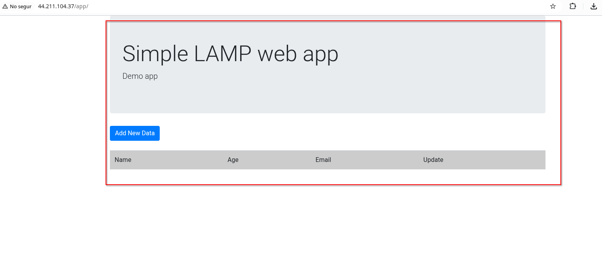
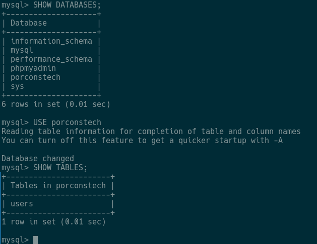
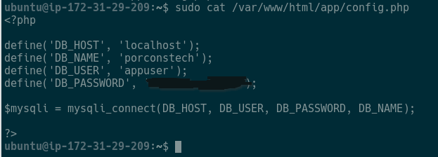

# Sprint 4. Despliegue de una aplicación web LAMP sencilla

Implantación de Aplicaciones Web · 2.º ASIX · Curso 2026/2027 · PorçonsTech

Repositorio de entrega: https://github.com/Noggs69/Sprint4

La aplicación no se instala en un servidor nuevo. Se publica sobre la instancia EC2 que ya tiene la pila LAMP del Sprint 3.

| Dato | Valor |
| --- | --- |
| Instancia | `porconstech-web` |
| IP elástica | `44.211.104.37` |
| Aplicación | https://github.com/anamollabas/iaw-practica-lamp |
| Base de datos | `lamp_db` |
| Usuario MySQL de la aplicación | `lamp_app`@`localhost` |

## Qué es la aplicación

El repositorio de la profesora es un CRUD mínimo en PHP. Los ficheros que Apache debe publicar están en `src/`:

| Fichero | Función |
| --- | --- |
| `index.php` | Lista los registros (Read) |
| `add.php` | Crea un registro (Create) |
| `edit.php` | Modifica un registro (Update) |
| `delete.php` | Elimina un registro (Delete) |
| `config.php` | Conexión con MySQL |

La estructura de la base está en `db/database.sql` del mismo repositorio. Solo hay una tabla, `users`, con `id`, `name`, `age` y `email`. Esos cuatro campos son los que muestran y editan las páginas PHP.

## Arquitectura

Sigue habiendo un único servidor. Apache, PHP y MySQL están en la misma EC2, así que la aplicación llega a la base de datos por `localhost`.

```
Navegador
    ↓
Apache recibe la petición
    ↓
PHP ejecuta el código de la aplicación
    ↓
PHP consulta o modifica datos en MySQL
    ↓
Apache devuelve la respuesta al navegador
```

El puerto que hay que tener abierto sigue siendo el 80. MySQL no se publica a internet: el 3306 permanece cerrado.

## Despliegue

En la instancia, con Apache, PHP y MySQL ya activos:

```bash
sudo systemctl status apache2
sudo systemctl status mysql
php --version

git clone https://github.com/anamollabas/iaw-practica-lamp.git
sudo mkdir -p /var/www/html/practica
sudo cp -a iaw-practica-lamp/src/. /var/www/html/practica/
sudo cp /ruta/Sprint4/conf/config.example.php /var/www/html/practica/config.php
sudo nano /var/www/html/practica/config.php
```

En `config.php`, en el servidor, se sustituye `CAMBIA_AQUI` por la contraseña real de `lamp_app`. Ese fichero no se sube a GitHub.

La base de datos:

```bash
sudo mysql < sql/estructura.sql
```

Después se crea el usuario `lamp_app` con las sentencias que están comentadas al final de `sql/estructura.sql`, usando una contraseña que solo existe en el servidor.

Permisos: Apache corre como `www-data` y solo necesita leer los PHP. Los ficheros quedan en `644` y el directorio en `755`. `config.php` puede quedar `640` y grupo `www-data`, para que el resto de usuarios del sistema no lean la contraseña.

La aplicación queda en:

http://44.211.104.37/practica/

## E1. Aplicación publicada



La petición sale del navegador hacia el puerto 80 de la IP elástica. Apache la recibe y, como el fichero es `.php`, lo entrega al intérprete. PHP monta el HTML con los datos que ha leído de MySQL y Apache devuelve esa página al navegador.

La captura se guarda en `imatges/e1-aplicacio.png` cuando la página ya carga en el navegador.

## E2. Base de datos preparada



La aplicación no guarda nada en ficheros. Cada fila de la lista es una fila de `users`. Sin esa tabla, `index.php`, `add.php`, `edit.php` y `delete.php` no tienen dónde leer ni escribir el nombre, la edad y el correo.

La captura de las tablas se guarda en `imatges/e2-base-dades.png`.

## E3. Configuración de la conexión


La plantilla pública es `conf/config.example.php`. En el servidor se copia a `config.php` y ahí se pone la contraseña. Esta tabla no incluye el secreto.

| Parámetro | Valor o función |
| --- | --- |
| `DB_HOST` | `localhost` |
| `DB_NAME` | `lamp_db` |
| `DB_USER` | `lamp_app` |
| `DB_PASSWORD` | Configurada, no se publica |

`localhost` encaja porque PHP y MySQL están en la misma máquina. El tráfico no sale de la instancia y no hace falta abrir el puerto de MySQL en el grupo de seguridad.

## E4. CRUD verificado


La prueba consiste en crear o editar una persona desde el formulario y volver a abrir el listado, o a consultar `users` desde el cliente MySQL. Si el cambio aparece en los dos sitios, PHP no solo ha pintado una página: ha escrito en la base de datos y una lectura posterior lo confirma.

Las capturas se guardan en `imatges/e4a-abans.png` y `imatges/e4b-despres.png`.

## Ficheros de esta entrega

```
.
├── README.md
├── .gitignore
├── conf
│   └── config.example.php
├── imatges
└── sql
    └── estructura.sql
```

`.gitignore` deja fuera `.env`, `config.php`, claves `.pem` y `.key`.

## Preguntas de comprensión

1. Apache puede estar activo y aun así la aplicación no funciona. Apache solo entrega ficheros. Si PHP no procesa el código o MySQL no acepta la conexión, la página sale en blanco, muestra el código fuente o enseña un error de base de datos.

2. PHP es quien ejecuta la lógica entre los dos. Apache le pasa la petición, PHP abre la conexión, lanza el `SELECT`, `INSERT`, `UPDATE` o `DELETE` y construye el HTML que Apache devuelve.

3. MySQL rechaza el acceso. La página puede cargar el HTML estático, pero cualquier consulta falla porque el usuario o la contraseña no coinciden con una cuenta que tenga permisos sobre `lamp_db`.

4. Porque los dos servicios están en la misma EC2. `localhost` apunta al MySQL local. No hay un segundo servidor de base de datos al que llegar por la red.

5. Primero miraría el error exacto que muestra PHP. Después comprobaría que en `config.php` el nombre de la base, el usuario, la contraseña y el host coinciden con MySQL. Por último comprobaría que la tabla `users` existe y que `lamp_app` tiene permisos sobre ella.

6. Que MySQL esté activo solo dice que el servicio arranca. Un CRUD demuestra el camino completo: PHP escribe un dato y, al volver a leerlo, el cambio sigue guardado. Si la conexión estuviera mal, el alta no sobreviviría a una consulta nueva.

## Comprobaciones

| Comprobación | Resultado |
| --- | --- |
| ¿Apache está activo? | Sí, en la instancia del Sprint 3 |
| ¿PHP se procesa correctamente? | Sí, `info.php` ya respondía |
| ¿MySQL está activo? | Sí, forma parte de la pila ya instalada |
| ¿La aplicación es accesible desde el navegador? | Pendiente de publicar `src/` y añadir la captura E1 |
| ¿La aplicación conecta con MySQL? | Pendiente de crear `lamp_db`, `lamp_app` y `config.php` |
| ¿Una operación CRUD modifica realmente los datos? | Pendiente de la prueba y de las capturas E4 |
| ¿No has publicado ninguna contraseña o credencial? | Sí |

## Referencias

- [Repositorio de la aplicación](https://github.com/anamollabas/iaw-practica-lamp)
- [Apache HTTP Server](https://httpd.apache.org/)
- [PHP](https://www.php.net/)
- [MySQL](https://www.mysql.com/)
- [Markdown en GitHub](https://docs.github.com/es/get-started/writing-on-github/getting-started-with-writing-and-formatting-on-github/basic-writing-and-formatting-syntax)
